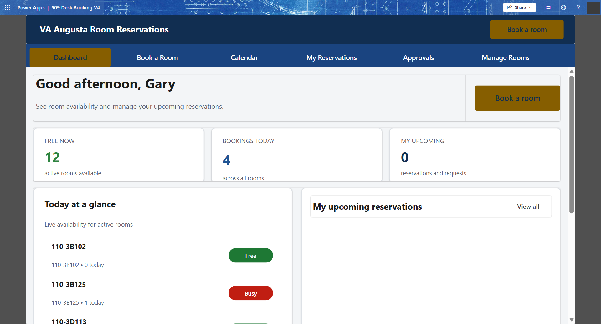
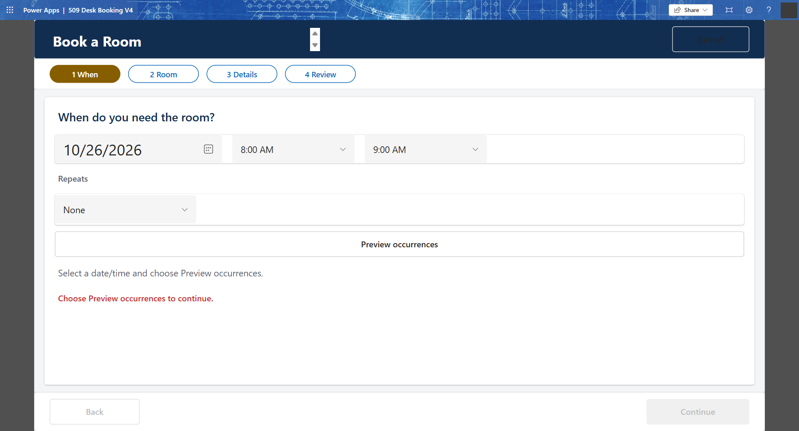
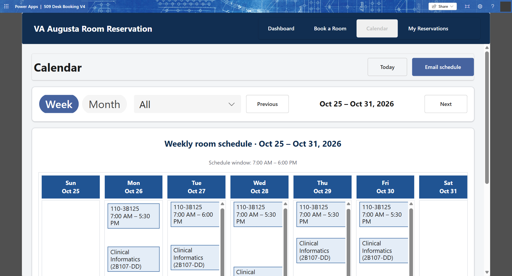
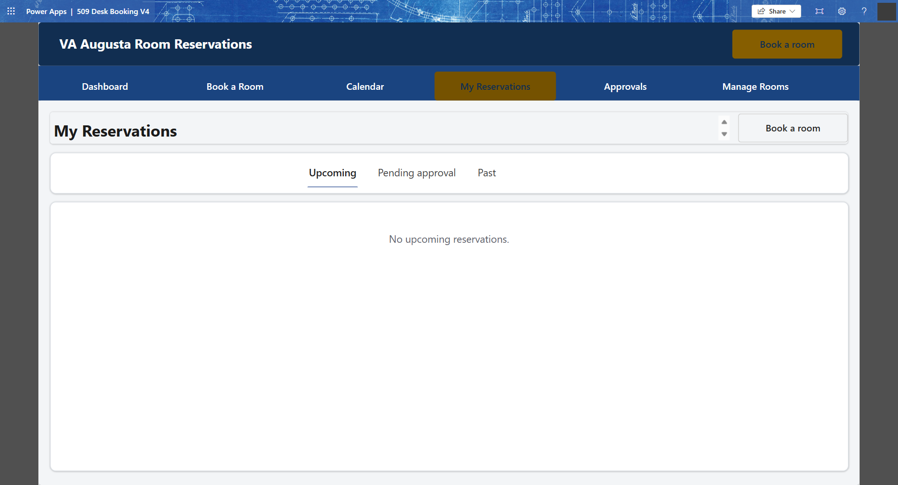
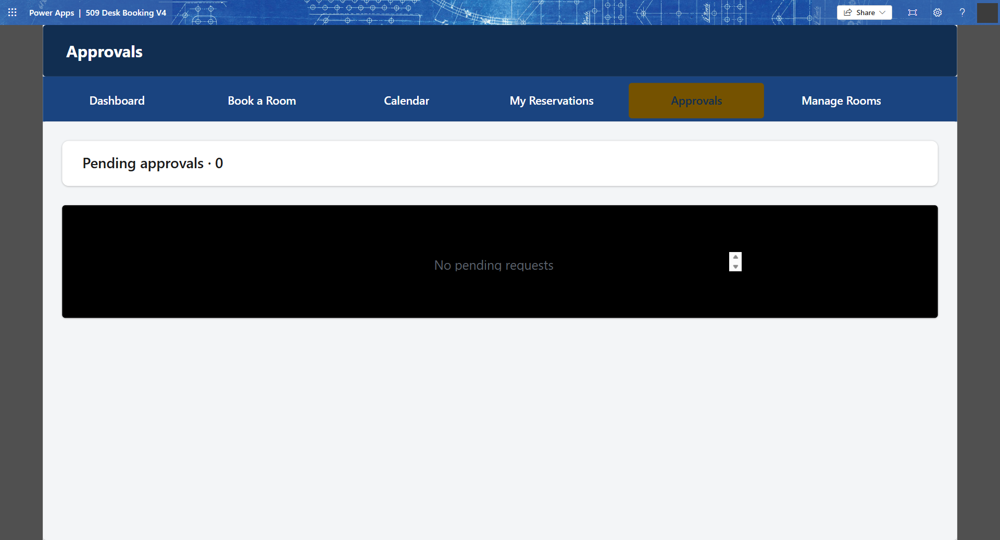
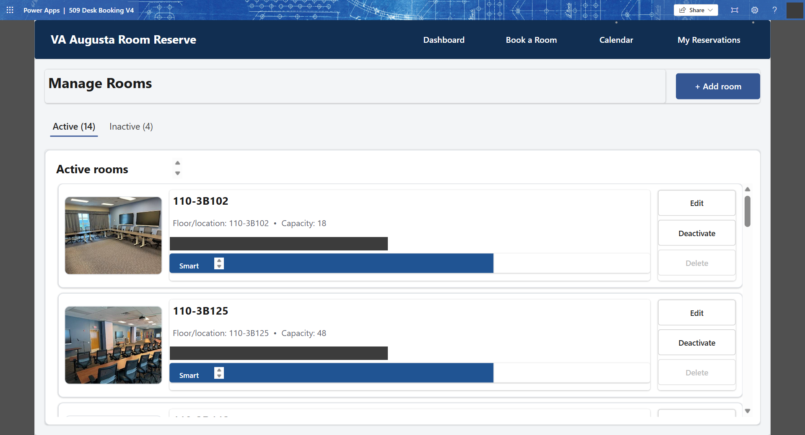

# 509 Desk Booking V4 (VA Augusta Room Reservations)

Power Apps **Canvas app** (GCC High) for reserving rooms, desks and items at the Augusta VA, with optional approval workflow and Outlook calendar sync.

- **Package:** `ReservationAPPV4_20261026172222.zip` (import via Power Apps > Apps > Import canvas app)
- **Connectors:** Office365Users, Office365 Outlook, SharePoint
- **Data site:** a SharePoint site holding the three lists below (re-point the data sources after import)

## Screens

| Screen | Screenshot |
|---|---|
| Dashboard |  |
| Book a Room |  |
| Calendar |  |
| My Reservations |  |
| Approvals |  |
| Manage Rooms |  |

Other screens in source: ReleaseNotes, scrn_WeeklyCal, scrn_MoCalendar, ManageDesks, MyAppts, BookRoom, Approvals.

## SharePoint data model

### Desks

| Field (internal) | Type | Used for |
|---|---|---|
| Title | Text | Room / desk / item name |
| Description | Multi-line text | Description |
| MapLink | URL | Link to map |
| Active | Number | 1 = bookable |
| Floor (display "RoomLocation") | Text | Location / floor |
| Asset | Choice: Room, Desk, Item | Resource type |
| DeskLocation | URL | Location link |
| Capacity | Text | Seating capacity |
| RoomPicture | URL | Picture link |
| Division | Choice: Uptown, Downtown | Campus |
| POC | Person | Point of contact |
| SecondPOC | Person | Secondary contact |
| VTel | URL | VTel availability link |
| Projector_x002f_TV | URL | Projector/TV info |
| SmartBoard | URL | SmartBoard info |
| RoomPhoto | Multi-line text | Base64 photo |
| RoomMap | Multi-line text | Base64 map |
| RoomUseApprovalRequired | Yes/No (default No) | Booking needs approval |
| NotifythisPersonforApproval | Person | Approver |

### Desk Reservations

| Field (internal) | Type | Used for |
|---|---|---|
| Title | Text (required) | Meeting / reservation title |
| DeskText | Text | Reserved resource name |
| ReservedBy | Person | Requester |
| CheckOutFrom / CheckOutTo | Date & time | Start / end |
| CheckOutFromText / CheckOutToText | Text | Display strings |
| CheckOutFromNumber / CheckOutToNumber | Number | Sortable/overlap-check values |
| Manager | Person | Requester's manager |
| Service | Text | Service / section |
| Description | Text | Details |
| Reasonfordeskreservation | Text | Reason |
| RoomReservation | Yes/No | Room vs desk |
| Asset | Choice: Room, Desk | Resource type |
| DeskFloor | Text | Floor / location |
| IsRecurring | Yes/No | Recurring series flag |
| RecurrenceFrequency | Text | Frequency |
| RecurrenceEndDate | Date & time | Series end |
| RecurrencePattern | Choice: Mon-Sun | Day of week |
| RecurrenceDayName | Text | Day name |
| RecurrenceTimes | Text | Occurrence count |
| RecurrenceID | Number | Series id |
| ParentReservationID | Lookup | Parent reservation |
| MeetingCatagory | Text | Category (original spelling) |
| OptionalAttendees | Person (multi) | Optional attendees |
| OutlookEventID / OutlookSeriesID | Multi-line text | Outlook sync ids |
| ApprovalStatus | Text | Pending / Approved / Denied |
| ApprovalReason | Multi-line text | Decision reason |
| ApprovalDecisionBy | Text | Approver |

### DeskAccessControl

| Field (internal) | Type | Used for |
|---|---|---|
| Title | Text | Label |
| EmployeeOrGroup (display "Admin") | Person | App admins |
