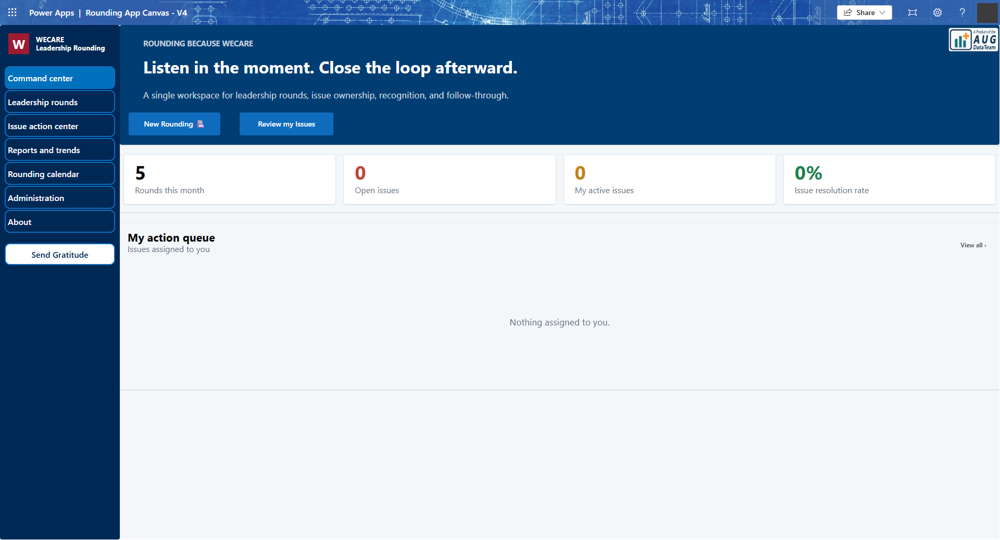
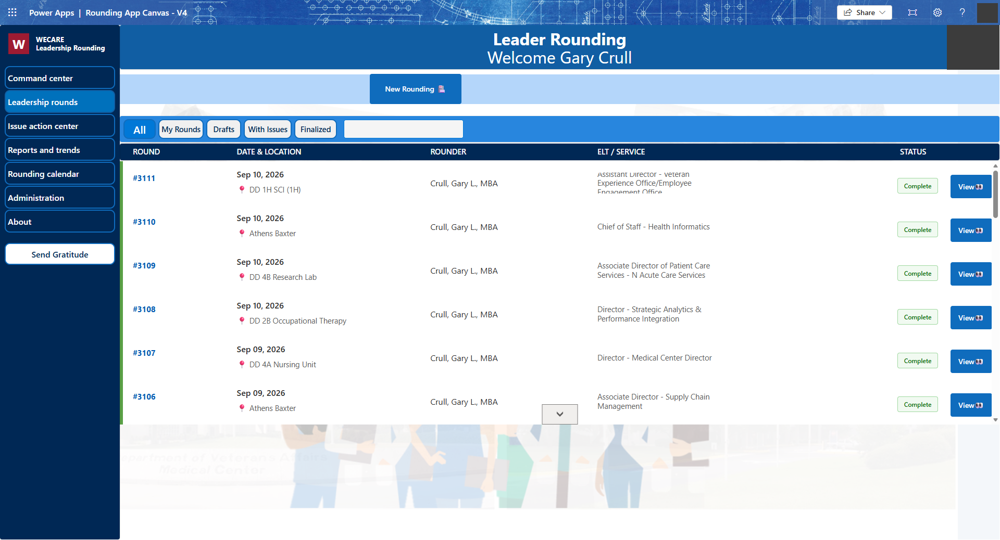
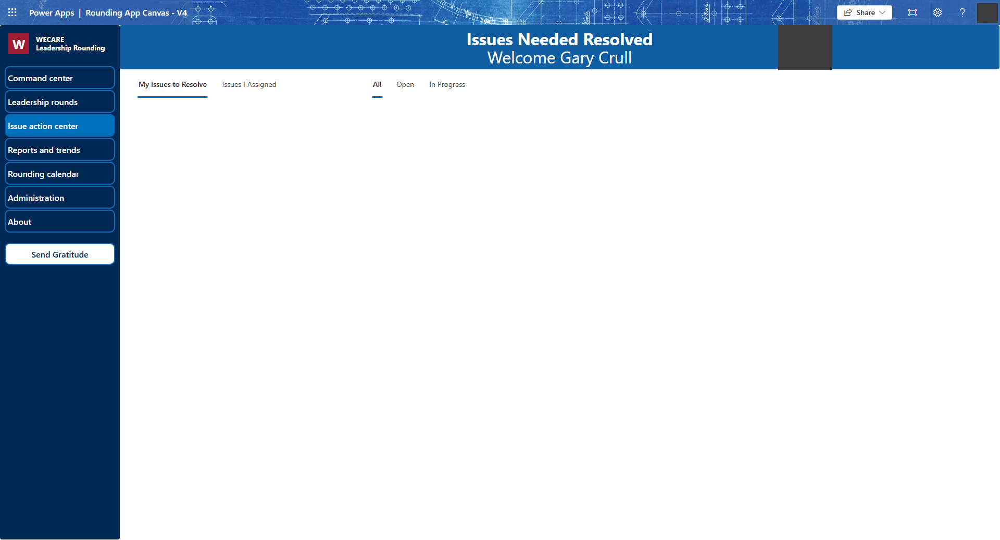
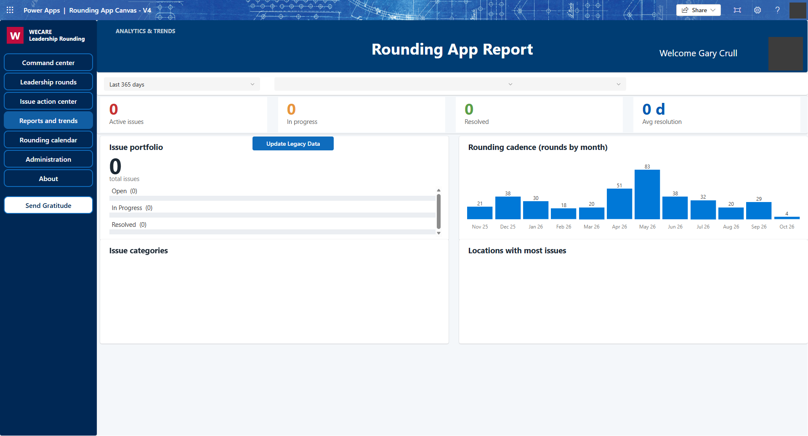
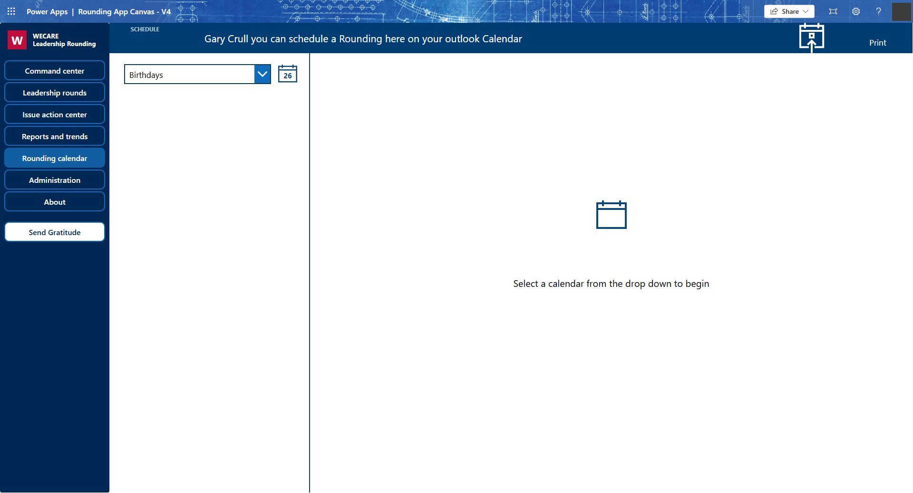
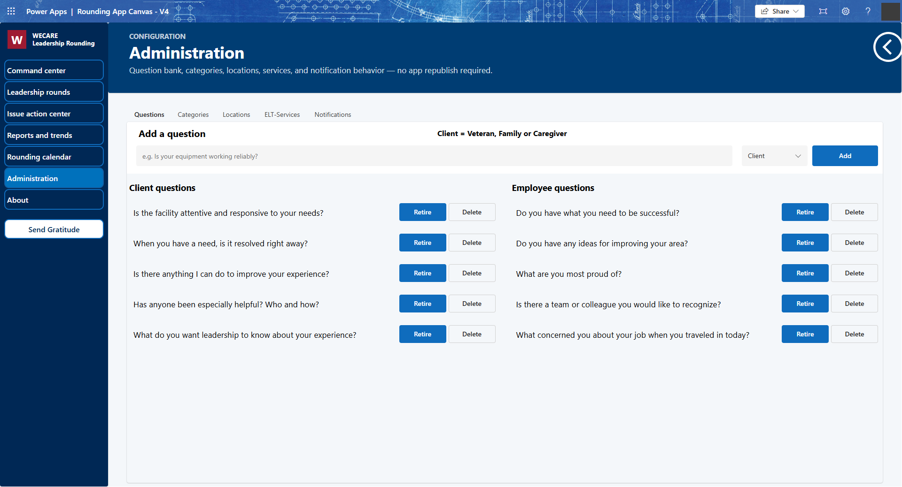
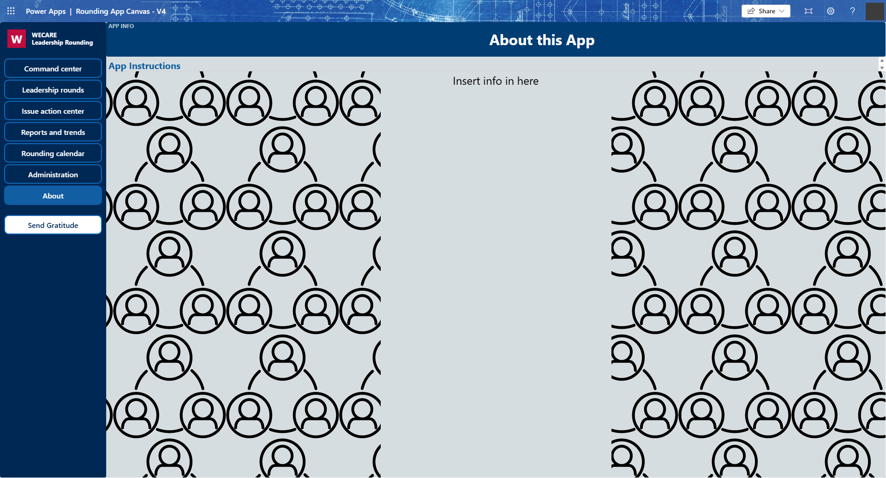

# Rounding App Canvas - V4 (WECARE Leadership Rounding)

Power Apps **Canvas app** (GCC High) for leadership rounding: record rounds, track issue ownership, recognise staff, and report trends.

- **Package:** `LeadershipRoundingV4_20261026172450.zip` (import via Power Apps > Apps > Import canvas app)
- **Data site:** a SharePoint site holding the lists below (re-point the data sources after import)

## Screens

| Screen | Screenshot |
|---|---|
| Command center |  |
| Leadership rounds |  |
| Issue action center |  |
| Reports and trends |  |
| Rounding calendar |  |
| Administration |  |
| About |  |

## SharePoint data model

Lists below were read from the live site.

### Rounding2

| Field (internal) | Type | Used for |
|---|---|---|
| Title | Text | Round title |
| DateRounded | Date & time | Round date |
| EmployeeWhoRounded / RounderName / RounderEmail | Person / Text | Rounder |
| Shifts | Choice: Night, Day, Evening | Shift |
| Service0 (display "Position"), Pentad (display "Office") | Text | ELT position / office rounded |
| Div | Choice: 1-5 | Division |
| Hallway (display "Zone") / HallWayText | Choice (1A..GC, OTHER) / Text | Zone |
| LocDescription, LocFullDescription, OtherLocations, LocationID | Text | Location |
| Issues, Kudos, IssueResolvedComment | Multi-line text | Narrative |
| Client / employee question answers (14 fields), AnswersJson | Multi-line text | Responses |
| EmployeeWhobroughtUpIssues, AssignedtoforIssue | Person | Issue raiser / owner |
| IssueComplexity | Choice: Level 1-3 | Complexity |
| ResolutionStatus | Choice: Working, Sent outside, not started | Resolution |
| ResolutionNote, GeneralComments | Text | Notes |
| Completed | Choice: Yes, No | Done |
| Dateissueresolved | Date & time | Resolved date |
| IssuePicture / ImageInfo | Thumbnail / Multi-line text | Photo |
| IsDraft | Yes/No | Draft flag |
| accountId, Account, AppType, iPhonePCCreate, iPhonePCRespond, DeepLink | Text | Legacy/link fields |

### RoundingIssues

| Field (internal) | Type | Used for |
|---|---|---|
| Title | Text | Issue title |
| RoundingID | Number | Parent round |
| QuestionCategory | Choice: Processes, Staffing, Compensation, Conduct, Communication, Budget, Facilities, Supplies, Privacy, Physical Security, Access, Employee Burnout, Client Concerns | Category |
| QuestionText, IssueDetail | Multi-line text | Detail |
| Status | Choice: Open, In Progress, Resolved | Status |
| AssignedTo, AssignedBy | Person | Owner / assigner |
| AssignedToEmail(s), AssignedToNames, AssignedByEmail, AssignedByName | Text | Denormalised owner info |
| DueDate, ResolvedDate, DateRounded | Date & time | Dates |
| ResolutionNote | Multi-line text | Resolution |
| FollowUpNeeded, FollowupRequested, ReminderRequested | Yes/No / Text | Follow-up |
| EmailSent, TeamsSent, NotifyChannels | Yes/No / Text | Notification tracking |
| IssueImage, ImagesJson | Thumbnail / Multi-line text | Images |
| Location, Audience, StatusText, CategoryText | Text | Display helpers |
| CreatedByEmail, RaisedByName, RaisedByEmail, ClientRaisedByfreetext(0) | Text | Raiser |
| IsDraft | Yes/No | Draft flag |

### RoundingResponses

| Field | Type | Used for |
|---|---|---|
| Title | Text | Label |
| RoundID | Number | Parent round |
| QuestionText, Answer | Multi-line text | Q and A |
| Audience, Location | Text | Client/Employee, place |
| DateRounded | Date & time | Round date |

### RoundingMemberCheck

| Field | Type | Used for |
|---|---|---|
| Title | Text (required) | Label |
| Employee | Person | Authorised member |

### LocationsList

| Field (display) | Type | Used for |
|---|---|---|
| Title ("Division") | Text | Division |
| Div, Description, FullDescription | Text | Location text |
| LocationDescription ("LocationAddress") | Text | Address |
| Hall ("Zone") | Text | Zone |
| RoundingCount, AssetType, State, County, Rurality | Text | Metadata |

### QuestionBank

| Field | Type | Used for |
|---|---|---|
| Title | Text (required) | Key |
| QuestionText | Multi-line text | Question |
| Audience | Text | Client / Employee |
| Active | Text | Active flag |
| SortOrder | Number | Order |

### ELT-Services

| Field (display) | Type | Used for |
|---|---|---|
| ELT ("Office") | Text | Office |
| Service ("Position") | Text | Position |
| PartOfMedCenter, ELTAbbrev, SvcAbbrev | Text | Grouping / abbreviations |
| POC | Person | Contact |

### AppSettings

| Field | Type | Used for |
|---|---|---|
| Title (required) | Text | Setting key |
| Value | Text | Setting value |
